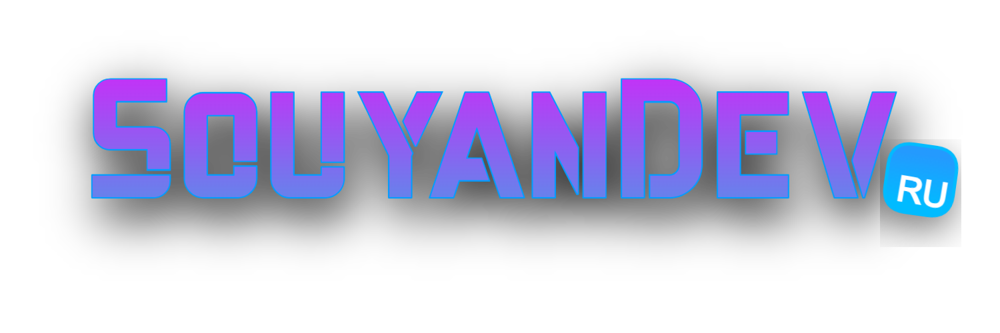

<!-- Header Banner -->
<p align="center">
  
</p>

<h1 align="center">Hey, I'm Souyan 👋</h1>

<p align="center">
  <strong>Software Developer · Minecraft Plugin Developer · Builder of RuLang</strong>
</p>

<p align="center">
  <em>Build. Break. Learn. Repeat.</em>
</p>

<p align="center">
  <a href="https://www.souyande.xyz/">Portfolio</a>
  ·
  <a href="https://github.com/SanityGuy">GitHub</a>
</p>

---

### `> whoami`

```typescript
const souyan = {
    role: "Software Developer",
    motto: "Build. Break. Learn. Repeat.",

    technologies: [
        "JavaScript",
        "TypeScript",
        "Java",
        "Python",
        "React",
        "Go"
    ],

    building: [
        "EmCapture",
        "SkyFlix",
        "RuLang",
        "TDL"
    ]
};

console.log("Welcome to my GitHub.");
```

### `> what I'm building`

| Project | Focus |
| --- | --- |
| **RuLang** | Exploring programming language design |
| **EmCapture** | Application development |
| **SkyFlix** | Software project development |
| **TDL** | Building and experimenting with software |

### `> tech stack`

<p align="center">
  
</p>

### `> github analytics`

<p align="center">
  
  
</p>

### `> support my work`

Enjoying what I build? You can support my independent development through **Saweria**.

<p align="center">
  <a href="https://saweria.co/souyandev">
    
  </a>
</p>

<p align="center">
  <sub>Indonesian Rupiah (IDR) only.</sub>
</p>

---

<p align="center">
  <sub>Designed with curiosity. Built through experimentation.</sub>
</p>
